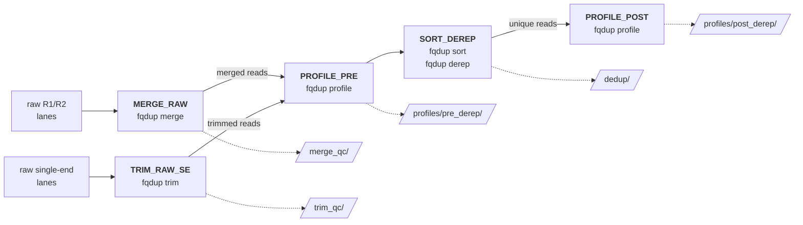

# fqdup-qc-nextflow

A Nextflow workflow for ancient-DNA read QC with [fqdup](https://github.com/genomewalker/fqdup). It takes raw paired-end or single-end lanes per sample and produces merge or trim QC, a reference-free damage profile before and after deduplication, and deduplicated reads ready for mapping or classification.



- **[Tutorial](docs/tutorial.md)**: run the bundled test, read the results, then run your own samples.
- **[Outputs](docs/outputs.md)**: every output file and field, and how to read the damage profile.

## Quick start

```bash
nextflow run genomewalker/fqdup-qc-nextflow -profile test --outdir test-results
```

The test runs two synthetic samples in a few minutes: one paired-end (5,000 read pairs, two lanes) and one single-end, made of the same R1 lanes.

## Requirements

- Nextflow 25.10 or later.
- [fqdup](https://github.com/genomewalker/fqdup) with `fqdup trim --single-end` (2.1.1 or later for paired-end only), on `PATH` or given with `--fqdup /path/to/fqdup`.
- `python3`, `gzip` and `sha256sum`.

## Input

A tab-separated manifest with a header row and one row per sample:

| Column | Required | Meaning |
|---|---|---|
| `sample` | yes | sample ID, used in output names: letters, digits, `_`, `.`, `-` |
| `r1_files` | yes | comma-separated R1 FASTQs, one per lane |
| `r2_files` | yes | comma-separated R2 FASTQs, in the same lane order; empty for a single-end sample |
| `layout` | no | `PE` (default) or `SE`; a single-end sample must say `SE`, so a missing R2 is never read as single-end |
| `library_type` | no | `ds`, `ss`, `auto` or `unknown`; defaults to `--library_type` |
| anything else | no | copied verbatim into the merge or trim provenance file |

Paired-end and single-end samples can share one manifest. Relative paths resolve against the manifest's directory. [test/samples.tsv](test/samples.tsv) is a working example.

```bash
nextflow run genomewalker/fqdup-qc-nextflow --manifest samples.tsv --outdir results
```

## Outputs

| Directory | Files per sample | What it tells you |
|---|---|---|
| `merge_qc/` | `merge-outcomes.tsv`, `merge.log`, `merge.provenance.txt` | paired-end: merge yield, merge cutoff, provenance |
| `trim_qc/` | `trim-report.tsv`, `trim.log`, `trim.provenance.txt` | single-end: reads and bases kept and clipped, provenance |
| `profiles/pre_derep/` | `profile-pre.html`, `.json`, `.tsv`, `pre.tdmg` | damage profile of all merged or trimmed reads |
| `dedup/` | `dedup.fq.gz`, `clusters.tsv.gz`, `derep.provenance.txt` | deduplicated reads and duplicate clusters |
| `profiles/post_derep/` | `profile-post.html`, `.json`, `.tsv`, `post.tdmg` | damage profile after dedup; report this one |

Start with the HTML report. For the call, read `characterization.verdict.deamination` in the profile JSON. The JSON also covers oxidation, depurination and fragmentation. [docs/outputs.md](docs/outputs.md) explains each file and every damage type.

For paired-end samples only merged reads are kept. Unmerged pairs and orphan reads are counted in `merge-outcomes.tsv` but not written. For single-end samples every read that is still long enough after adapter trimming is kept. Dedup runs per sample, over all of its lanes.

## Parameters

| Parameter | Default | Meaning |
|---|---|---|
| `--manifest` | | sample manifest (required) |
| `--outdir` | `results` | output directory |
| `--fqdup` | `fqdup` | fqdup binary |
| `--fqdup_sha256` | | when set, every stage refuses any other fqdup binary |
| `--fqdup_revision` | `unrecorded` | label written to the provenance files |
| `--merge_min_length` | `16` | minimum merged read length |
| `--se_min_length` | `16` | minimum single-end read length after trimming |
| `--se_adapter3` | TruSeq read 1 adapter | 3′ adapter clipped from single-end reads |
| `--se_adapter_min_overlap` | `5` | shortest adapter prefix clipped at a read's 3′ end |
| `--library_type` | `auto` | default when the manifest has no `library_type` column |

## Profiles and site configuration

- `test`: the bundled synthetic samples, run locally with small resources.
- `slurm`: submits each task to Slurm.

Put cluster settings in your own config and pass it with `-c site.config -profile <name>`. That covers queues, other executors such as HyperQueue, resource changes and binary pins; the [tutorial](docs/tutorial.md#5-resources-and-where-to-run) has an example. Profiles with the same name merge with the ones here.

## License

MIT. See [LICENSE](LICENSE).
