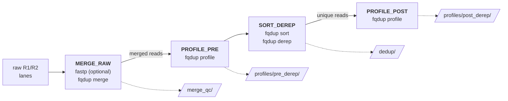

# fqdup-qc-nextflow

A Nextflow workflow for ancient-DNA read QC with [fqdup](https://github.com/genomewalker/fqdup). It takes raw paired-end lanes per sample and produces merged-read QC, a reference-free damage profile before and after deduplication, and deduplicated reads ready for mapping or classification.




*Terminal base composition of the bundled test sample. The rise at both read ends is ancient-DNA deamination. [How to read it](docs/outputs.md#2-damage-profile-profilespre_derep-and-profilespost_derep).*

- **[Tutorial](docs/tutorial.md)**: run the bundled test, read the results, then run your own samples.
- **[Outputs](docs/outputs.md)**: every output file and field, and how to read the damage profile.

## Quick start

```bash
nextflow run genomewalker/fqdup-qc-nextflow -profile test --outdir test-results
```

The test runs one synthetic sample (5,000 read pairs, two lanes) through all four stages in a few minutes. It uses fqdup's own merge filters, so fastp is not needed.

## Requirements

- Nextflow 25.10 or later.
- [fqdup](https://github.com/genomewalker/fqdup) on `PATH`, or `--fqdup /path/to/fqdup`.
- [fastp](https://github.com/OpenGene/fastp), only with `--trim_mode fastp` (the default).
- `python3`, `gzip` and `sha256sum`.

## Input

A tab-separated manifest with a header row and one row per sample:

| Column | Required | Meaning |
|---|---|---|
| `sample` | yes | sample ID, used in output names: letters, digits, `_`, `.`, `-` |
| `r1_files` | yes | comma-separated R1 FASTQs, one per lane |
| `r2_files` | yes | comma-separated R2 FASTQs, in the same lane order |
| `library_type` | no | `ds`, `ss`, `auto` or `unknown`; defaults to `--library_type` |
| anything else | no | copied verbatim into the merge provenance file |

Relative paths resolve against the manifest's directory. [test/samples.tsv](test/samples.tsv) is a working example.

```bash
nextflow run genomewalker/fqdup-qc-nextflow --manifest samples.tsv --outdir results
```

## Outputs

| Directory | Files per sample | What it tells you |
|---|---|---|
| `merge_qc/` | `merge.json`, `damage.json`, `subst.tsv`, `merge.provenance.txt`, `fastp-reports.tar.gz` | merge yield, library type, overlap-based damage, provenance |
| `profiles/pre_derep/` | `profile-pre.html`, `.json`, `.tsv`, `pre.tdmg` | damage profile of all merged reads |
| `dedup/` | `dedup.fq.gz`, `clusters.tsv.gz`, `derep.provenance.txt` | deduplicated reads and duplicate clusters |
| `profiles/post_derep/` | `profile-post.html`, `.json`, `.tsv`, `post.tdmg` | damage profile after dedup; report this one |

Start with the HTML report. For the call, read `characterization.verdict.deamination` in the profile JSON. [docs/outputs.md](docs/outputs.md) explains each file.

Only merged reads are kept. Unmerged pairs and orphan reads are counted in `merge.json` but not written. Dedup runs per sample, over all of its lanes.

## Parameters

| Parameter | Default | Meaning |
|---|---|---|
| `--manifest` | | sample manifest (required) |
| `--outdir` | `results` | output directory |
| `--fqdup` | `fqdup` | fqdup binary |
| `--fqdup_sha256` | | when set, every stage refuses any other fqdup binary |
| `--fqdup_revision` | `unrecorded` | label written to the provenance files |
| `--fastp` | `fastp` | fastp binary |
| `--fastp_sha256` | | when set, refuses any other fastp binary |
| `--trim_mode` | `fastp` | `fastp` trims each lane before merge; `fqdup` uses only fqdup's merge filters |
| `--merge_min_length` | `16` | minimum merged read length |
| `--merge_min_entropy` | `0.0` | low-complexity filter: Shannon entropy floor in bits (0 = off) |
| `--library_type` | `auto` | default when the manifest has no `library_type` column |

## Profiles and site configuration

- `test`: the bundled synthetic sample, run locally with small resources.
- `slurm`: submits each task to Slurm.

Put cluster settings in your own config and pass it with `-c site.config -profile <name>`. That covers queues, other executors such as HyperQueue, resource changes and binary pins; the [tutorial](docs/tutorial.md#5-resources-and-where-to-run) has an example. Profiles with the same name merge with the ones here.

## License

MIT. See [LICENSE](LICENSE).
