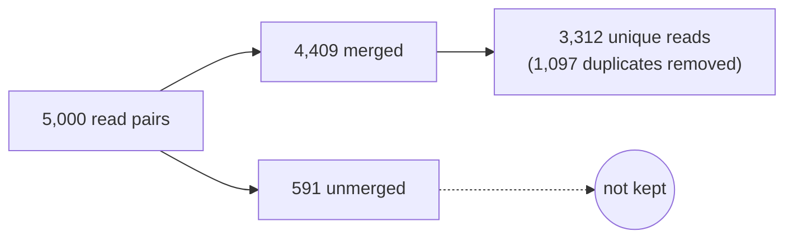
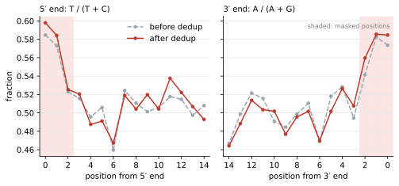

# Outputs and how to read them

Files are named `<sample>.<kind>`. The example values come from the bundled test sample (`-profile test`), a synthetic double-stranded library with simulated damage.

```
results/
├── merge_qc/
│   ├── <sample>.merge-outcomes.tsv     read pairs per merge outcome
│   ├── <sample>.merge.log              merge cutoff and run diagnostics
│   └── <sample>.merge.provenance.txt   fqdup binary, host, time, manifest row
├── profiles/pre_derep/
│   ├── <sample>.profile-pre.html       interactive damage report
│   ├── <sample>.profile-pre.json       full damage profile
│   ├── <sample>.profile-pre.tsv        damage curve by position
│   └── <sample>.pre.tdmg               damage fit for DART
├── dedup/
│   ├── <sample>.dedup.fq.gz            deduplicated reads
│   ├── <sample>.clusters.tsv.gz        one row per duplicate cluster
│   └── <sample>.derep.provenance.txt
└── profiles/post_derep/                same four files as pre_derep, after dedup
```

## Where the reads go



Only merged reads continue past merge. Dedup runs within each sample, over all of its lanes, and never across samples.

## 1. Merge: `merge_qc/`

`fqdup merge` overlaps R1 with the reverse complement of R2, clips adapter, and collapses each overlapping pair into one read. Short ancient-DNA inserts usually overlap completely. All lanes of a sample are merged into one FASTQ, which is passed on but not published.

### `merge-outcomes.tsv`

Read pairs from all lanes, by outcome:

| `outcome` | Meaning | Test |
|---|---|---|
| `merged` | pair collapsed into one read; the only reads kept | 4,409 |
| `unmerged` | no acceptable overlap | 591 |
| `orphan_r1`, `orphan_r2` | only one mate passed | 0, 0 |
| `dropped` | neither mate passed | 0 |
| `total` | read pairs in | 5,000 |

The task fails if the outcomes do not add up to `total`. The merge yield is `merged / total`. A drop in yield across samples usually points to adapter or insert-length problems.

### `merge.log`

fqdup's merge messages. The `CUTOFF_FLOOR` line records the merge cutoff:

```
CUTOFF_FLOOR library=lane1_R1.fq.gz floor=0.0178 effective=0.316 requested=0.316
```

`floor` is the lowest cutoff fqdup certifies for this library from its own data, and a requested cutoff below it is raised to it. `effective` is the cutoff used. `MERGE_CHUNK` and `MERGE_MEMO` lines are run diagnostics.

### `merge.provenance.txt`

`key=value` lines: sample, declared library type, lane count, fqdup revision label, SHA-256 of the fqdup binary, timestamp, host. It is followed by the full manifest row:

```
manifest.sample=synthetic_L1
manifest.r1_files=lane1_R1.fq.gz,lane2_R1.fq.gz
manifest.r2_files=lane1_R2.fq.gz,lane2_R2.fq.gz
manifest.library_type=auto
```

Any extra manifest column, such as a source ID or a control flag, appears here unchanged.

## 2. Damage profile: `profiles/pre_derep/` and `profiles/post_derep/`

`fqdup profile`, built on [libtaph](https://github.com/genomewalker/libtaph), estimates ancient-DNA damage without a reference. Cytosine deamination in single-stranded overhangs makes C read as T near the 5′ end, and G read as A near the 3′ end of double-stranded libraries. The profile measures this as base composition at the read ends compared with the read interior.

It runs twice: before and after dedup. **Report the post-dedup profile.** PCR duplicates give extra weight to over-amplified molecules, and dedup removes that bias. The two should agree closely; a large shift means duplicates were concentrated in a damage-biased part of the library.

### The damage curve: `profile-*.tsv`



The figure plots `freq5` and `freq3` from the test sample. Damage shows as the rise at the read ends over a flat interior. The height of that rise matters; the interior level does not, because it reflects base composition. Shaded positions are masked in the post-dedup profile.

| Column | Meaning |
|---|---|
| `pos` | distance from the read end, 0 to 14 |
| `end5`, `end3` | which end each value is measured from |
| `freq5` | T / (T + C) at that distance from the 5′ end |
| `freq3` | A / (A + G) from the 3′ end; T / (T + C) for single-stranded libraries |
| `freq5_gt` | T / (T + G) from the 5′ end, the 8-oxoguanine marker |
| `mask` | `1` if downstream tools should mask this position (excess deamination probability > 0.05) |
| `cov5`, `cov3`, `cov5_gt` | bases behind each value |

`-1` means coverage was too low to estimate.

### The HTML report: `profile-*.html`

The same curves and the length-stratified fits, with the headline numbers below. It is a single self-contained file that opens offline.

### Reading the profile JSON

Read it top-down and stop when you have your answer.

| Step | Field | Read it as | Test, after dedup |
|---|---|---|---|
| 1 Call | `characterization.verdict.deamination.call` | `present` / `absent`: is there authenticated age-related damage? | `present` |
| | `characterization.verdict.deamination.authenticated_by` | independent evidence behind the call: `channel_b`, `pi_estimate`, `d5_decay_fit`, `pinned_shallow_ct`, `none` | `channel_b` |
| | `characterization.verdict.deamination.confidence` | `high`, `shallow`, `low_shallow`, `none` | `high` |
| 2 Size | `characterization.damage_context.evidence.d_max_5` / `d_max_3` | terminal damage above the interior baseline | 0.20 / 0.14 |
| | `characterization.damage_context.evidence.lambda_5` | decay rate from the end; smaller reaches further into the read | 0.22 |
| | `characterization.damage_magnitude_recommended.absolute_estimate` | one number per library, when `absolute_estimate_valid` is `true` and it agrees with the verdict ([below](#when-fields-disagree)) | 0.0 |
| 3 Type | `library_call.library_type` | `double-stranded` / `single-stranded`; `library_call_overridden` is `true` if declared | `double-stranded` |
| 4 QC | `qc.library_artifact_contaminated` | adapter or ligation artefacts at the read ends; see `library_artifact_reasons` | `true`: `adapter_remnant_3prime`, `position0_artifact_3prime` |
| | `qc.library_qc.position0_artifact_5prime` / `_3prime` | depleted terminal base with rising positions 1–4: an artefact, not damage | `false` / `true` |
| 5 Other | `characterization.verdict.oxidation.call` | 8-oxoguanine; real but also caused by sample preparation | `none` |
| | `characterization.verdict.preservation.tier` | aggregate preservation index, separate from the deamination call | |

A rough scale for `d_max`, for libraries without enzymatic treatment:

| `d_max` | Signal |
|---|---|
| ≥ 0.20 | strong |
| 0.08–0.20 | typical Holocene |
| 0.02–0.08 | weak; rely on the verdict |
| < 0.02 | absent |

These are reference-free estimates and read somewhat lower than alignment-based tools such as metaDMG.

`absolute_estimate` of `null` means the fit was rejected, not that damage is zero.

Never judge a library on `d_max` alone. Look for these together:
- a confident verdict;
- curves that rise at the ends;
- no artefact flags.

### What else is in the JSON

The five steps above use a handful of fields. The rest of the file is grouped into six sections:

| Section | What it holds |
|---|---|
| `identity` | libtaph revision, `schema_version`, input file, `n_reads` |
| `library_call` | library type and the model comparison (`bic`) behind it |
| `characterization` | the summary layer: `verdict`, `damage_status`, `damage_magnitude_recommended`, `damage_context` (one score per process and the `dominant_process`), and `damage_types` |
| `qc` | artefact flags (`library_qc`), terminal motif enrichment (`end_motif_enrichment`), and the preservation index |
| `channels` | one block per detector, listed below |
| `diagnostics` | raw position and context tables behind the channels |

Work from the top: `characterization` summarises `channels`, and `channels` summarise `diagnostics`.

### Damage types: `characterization.damage_types`

Ancient DNA carries more than deamination. Each row is one detector, labelled by `channel`:

| Channel | `name` | Process | Signal it looks for | Test |
|---|---|---|---|---|
| A | `cytosine_deamination` | deamination | C→T at the 5′ end, G→A at the 3′ end (ds) | detected |
| B | `stop_codon_conversion` | deamination | CAA/CAG/CGA turned into stop codons by C→T; an independent check on A | detected |
| C | `8_oxog_top_strand` | oxidation (8-oxoguanine) | G→T stop codons at the read ends | not detected |
| D | `chargaff_gt_asymmetry` | oxidation (8-oxoguanine) | G→T against C→A strand imbalance; single-stranded libraries only | not applicable |
| E | `purine_enrichment` | depurination | excess A and G at read starts, where strands broke at abasic sites | not detected |
| F | `8_oxog_complement` | oxidation (8-oxoguanine) | C→A stop codons, the other strand's view of 8-oxoguanine | not detected |
| G | `cg_stop_enrichment` | empirical | C→G stop codons at the read ends | not detected |
| H | `at_stop_enrichment` | empirical | A→T stop codons; no known chemical pathway | not detected |

F, G and H appear twice. The `_3prime` rows report a rate only, without a detection call. A row's `detected` counts only when `valid` is also `true`. An empirical channel (`mechanism_status`) is a pattern without an established lesion behind it, so read it as a flag to look closer, not as a diagnosis.

Only deamination tells ancient from modern DNA. Oxidation is real but sample preparation also causes it, and depurination and fragment length are weak, indirect proxies. Use them to describe a library, not to authenticate it.

### Detector blocks: `channels`

| Process | Blocks |
|---|---|
| Deamination | `deamination`, `bulk_damage`, `mixture_model`, `d_max_cooccurrence`, `deam_context_spectrum` (C→T by sequence context, including CpG), `interior_ct_cluster`, `per_read_overdispersion` |
| Oxidation | `oxo_two_marker` (the source of the oxidation verdict), `oxog_estimate`, `oxidation_like`, `oxidation_epsilon`, `oxidative_scission`, `gc_depletion` |
| Depurination and breakage | `depurination`, `depurination_deconvolution`, `scission`, `fragmentation` |
| Other | `tau_discriminator` (hydrolytic against oxidative regime), `burial_fingerprint`, `context_primitives` |

`fragmentation` is the quickest of these to read: `median_length` and `short_fraction_lt_50bp` describe the fragment-length distribution. The test sample's median is 52 bp, with 40% of reads under 50 bp.

### When fields disagree

The JSON carries several answers to "is there damage, and how much?", and they do not always agree. The test sample shows three disagreements at once:

| Field | Test, after dedup |
|---|---|
| `characterization.verdict.deamination` | `present`, `channel_b`, `high`, `d_max_5prime` 0.20 |
| `channels.deamination.state` | `EXCESS_PRESENT_DECAY_UNAUTHENTICATED` (`unauthenticated_reason`: `FLAT_LOW_MAGNITUDE`) |
| `characterization.damage_magnitude_recommended` | `absolute_estimate` 0.0, `absolute_estimate_valid` `true`, from `mixture_model.damaged.d_max_5prime_fit` |
| `channels.mixture_model.valid` | `false` |
| `qc.library_artifact_contaminated` | `true` |

Resolve them in this order, following [libtaph's interpretation guide](https://genomewalker.github.io/libtaph/interpretation/):

1. **Present or absent: the verdict.** `characterization.verdict` combines the channels through cross-checks; individual blocks such as `channels.deamination` are inputs to it and can disagree in either direction.
2. **How much: `absolute_estimate`, only when it is valid and consistent.** Check `absolute_estimate_source`. If the block it names is itself not valid, as `mixture_model` is here, treat the estimate as unresolved and report the verdict's `d_max_5prime` with its confidence.
3. **Can it be trusted at all: the QC flags.** With `qc.library_artifact_contaminated` `true`, the end signal may be partly technical. Check `library_artifact_reasons` and resolve the named artefact before reporting amplitudes.

For the test sample: damage is present (verdict), about 0.20 at the 5′ end (verdict `d_max_5prime`), with a 3′ artefact warning that a real library would need resolved first.

Every field is documented in the [libtaph field reference](https://genomewalker.github.io/libtaph/fields/), with the chemistry of each channel in [damage types](https://genomewalker.github.io/libtaph/damage-types/).

### `pre.tdmg` / `post.tdmg`

The fitted damage model in a small binary file (header `TDM1`). [DART](https://github.com/genomewalker/dart) reads it with `--library-profile` instead of re-estimating damage.

## 3. Dedup: `dedup/`

`fqdup sort` orders the merged reads; `fqdup derep` collapses reads with identical sequence, including reverse-complement copies, into one cluster and writes one read per cluster. Damage is fitted and reported, but not used for clustering.

### `dedup.fq.gz`

One read per cluster, named after the original R1 read.

### `clusters.tsv.gz`

| Column | Meaning |
|---|---|
| `hash` | 128-bit fingerprint of the cluster sequence, hexadecimal |
| `seq_len` | length of the kept read |
| `count` | input reads in the cluster |

`count` sums to the merged read count, so `duplication = 1 − clusters / merged reads`. The test sample has 4,409 reads in 3,312 clusters: 24.9% duplicates. Many large clusters mean the library was sequenced close to exhaustion.

### `derep.provenance.txt`

Sample, input file, library type given to derep, fqdup SHA-256 and revision label, memory limit, timestamp, host.

## Library type through the stages

| Manifest `library_type` | Merge | Profiles and derep |
|---|---|---|
| `ds` or `ss` | passed as `--library-type` | use it |
| `auto` or `unknown` | not passed | each detects it on its own input |

With `auto`, check that the pre- and post-dedup profiles agree on `library_call.library_type`. Declaring the type settles any disagreement.

## Built-in checks

A task fails, and publishes nothing, when:
- a gzip file is corrupt (`gzip -t`);
- a FASTQ does not start with `@`;
- merge outcomes do not add up to the read pairs in;
- a JSON does not parse;
- an output is empty;
- a binary does not match a SHA-256 you pinned.

These checks catch truncated and empty files. They do not validate every FASTQ record.
