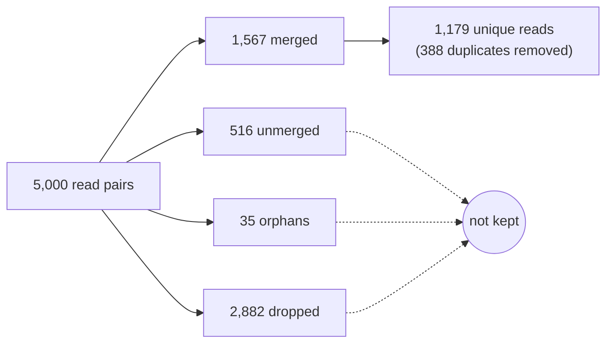

# Outputs and how to read them

Files are named `<sample>.<kind>`. The example values come from the bundled test sample (`-profile test`), a synthetic double-stranded library with simulated damage.

```
results/
├── merge_qc/
│   ├── <sample>.merge.json             merge counts, library type, adapters
│   ├── <sample>.damage.json            damage measured on R1/R2 overlaps
│   ├── <sample>.subst.tsv              R1 vs R2 substitution counts by position
│   ├── <sample>.merge.provenance.txt   binaries, host, time, manifest row
│   └── <sample>.fastp-reports.tar.gz   fastp reports per lane
├── profiles/pre_derep/
│   ├── <sample>.profile-pre.html       interactive damage report
│   ├── <sample>.profile-pre.json       full damage profile
│   ├── <sample>.profile-pre.tsv        damage curve by position
│   └── <sample>.pre.tdmg               damage fit for DART
├── dedup/
│   ├── <sample>.dedup.fq.gz            deduplicated reads
│   ├── <sample>.clusters.tsv.gz        one row per duplicate cluster
│   └── <sample>.derep.provenance.txt
└── profiles/post_derep/                same four files as pre_derep, after dedup
```

## Where the reads go



Only merged reads continue past merge. Dedup runs within each sample, over all of its lanes, and never across samples.

## 1. Merge: `merge_qc/`

`fqdup merge` overlaps R1 with the reverse complement of R2 and collapses each overlapping pair into one read. Short ancient-DNA inserts usually overlap completely. All lanes of a sample are merged into one FASTQ, which is passed on but not published.

### `merge.json`

| Field | Meaning | Test |
|---|---|---|
| `counts.pairs_in` | read pairs in, all lanes | 5,000 |
| `counts.merged` | pairs collapsed into one read; the only reads kept | 1,567 |
| `counts.unmerged` | passed QC, no acceptable overlap | 516 |
| `counts.orphan_r1`, `orphan_r2` | only one mate passed QC | 18, 17 |
| `counts.dropped` | both mates failed QC: too short after clipping, adapter dimers | 2,882 |
| `counts.balanced` | `true` if the counts add up; `false` means do not trust the run | `true` |
| `library.type` | `ds` or `ss` | `ds` |
| `library.type_source` | `declared` (from the manifest) or `detected` | `detected` |
| `library.udg` | coarse treatment screen: `none`, `half`, `full` | `half` |
| `adapters`, `complexity_gate`, `params` | adapters used, low-complexity thresholds, merge settings | |

The merge yield is `merged / pairs_in`. A drop in yield across samples usually points to adapter or insert-length problems. The test data has many very short inserts, which is why `dropped` is large there.

### `damage.json`

A damage profile built from the overlapping region of each pair, before the mates are collapsed. Damage shows as disagreement between the two mates, with no reference needed. It uses the same schema as the profile JSON, so read it the same way ([section 2](#reading-the-profile-json)). Use it as a second opinion when the main profile is unclear.

### `subst.tsv`

Lines starting with `#` carry the totals and a key. Then one row per position and base pair:

| Column | Meaning |
|---|---|
| `strand` | `fwd`: position from the insert's 5′ end · `rev`: from its 3′ end |
| `pos` | distance from that end, 0 = terminal base |
| `r1`, `rc2` | base in R1, and in reverse-complemented R2, at the same position |
| `count` | positions with that base pair |

| `r1` → `rc2` | Where | Signal |
|---|---|---|
| `T` → `C` | small `fwd` positions | 5′ deamination |
| `G` → `A` | small `rev` positions | 3′ deamination (double-stranded library) |
| `T` → `G` | any position | 8-oxoguanine |

### `merge.provenance.txt`

`key=value` lines: sample, declared library type, lane count, trim mode, fqdup revision label, SHA-256 of the fqdup and fastp binaries, timestamp, host. It is followed by the full manifest row:

```
manifest.sample=synthetic_L1
manifest.r1_files=lane1_R1.fq.gz,lane2_R1.fq.gz
manifest.r2_files=lane1_R2.fq.gz,lane2_R2.fq.gz
manifest.library_type=auto
```

Any extra manifest column, such as a source ID or a control flag, appears here unchanged.

### `fastp-reports.tar.gz`

The fastp JSON and HTML report for each lane, with `--trim_mode fastp`. With `--trim_mode fqdup` it holds only a note that fastp was skipped.

## 2. Damage profile: `profiles/pre_derep/` and `profiles/post_derep/`

`fqdup profile`, built on [libtaph](https://github.com/genomewalker/libtaph), estimates ancient-DNA damage without a reference. Cytosine deamination in single-stranded overhangs makes C read as T near the 5′ end, and G read as A near the 3′ end of double-stranded libraries. The profile measures this as base composition at the read ends compared with the read interior.

It runs twice: before and after dedup. **Report the post-dedup profile.** PCR duplicates give extra weight to over-amplified molecules, and dedup removes that bias. The two should agree closely; a large shift means duplicates were concentrated in a damage-biased part of the library.

### The damage curve: `profile-*.tsv`


The figure plots `freq5` and `freq3` from the test sample. Damage shows as the rise at the read ends over a flat interior. The height of that rise matters; the interior level does not, because it reflects base composition. Shaded positions are masked in the post-dedup profile.

| Column | Meaning |
|---|---|
| `pos` | distance from the read end, 0 to 14 |
| `freq5` | T / (T + C) at that distance from the 5′ end |
| `freq3` | A / (A + G) from the 3′ end; T / (T + C) for single-stranded libraries |
| `freq5_gt` | T / (T + G) from the 5′ end, the 8-oxoguanine marker |
| `mask` | `1` if downstream tools should mask this position (excess deamination probability > 0.05) |
| `cov5`, `cov3`, `cov5_gt` | bases behind each value |

`-1` means coverage was too low to estimate.

### The HTML report: `profile-*.html`

The same curves and the length-stratified fits, with the headline numbers below. It is a single self-contained file that opens offline.

### Reading the profile JSON

Read it top-down and stop when you have your answer.

| Step | Field | Read it as | Test, after dedup |
|---|---|---|---|
| 1 Call | `characterization.verdict.deamination.call` | `present` / `absent`: is there authenticated age-related damage? | `present` |
| | `characterization.verdict.deamination.authenticated_by` | independent evidence behind the call: `channel_b`, `pi_estimate`, `d5_decay_fit`, `pinned_shallow_ct`, `none` | `channel_b` |
| | `characterization.verdict.deamination.confidence` | `high`, `shallow`, `low_shallow`, `none` | `high` |
| 2 Size | `characterization.damage_context.evidence.d_max_5` / `d_max_3` | terminal damage above the interior baseline | 0.20 / 0.16 |
| | `characterization.damage_context.evidence.lambda_5` | decay rate from the end; smaller reaches further into the read | 0.15 |
| | `characterization.damage_magnitude_recommended.absolute_estimate` | one number per library; check `absolute_estimate_valid` | |
| 3 Type | `library_call.library_type` | `double-stranded` / `single-stranded`; `library_call_overridden` is `true` if declared | `double-stranded` |
| 4 QC | `qc.library_artifact_contaminated` | adapter or ligation artefacts at the read ends; see `library_artifact_reasons` | `false` |
| | `qc.library_qc.position0_artifact_5prime` / `_3prime` | depleted terminal base with rising positions 1–4: an artefact, not damage | `false` |
| 5 Other | `characterization.verdict.oxidation.call` | 8-oxoguanine; real but also caused by sample preparation | `none` |
| | `characterization.verdict.preservation.tier` | aggregate preservation index, separate from the deamination call | |

A rough scale for `d_max`, for libraries without enzymatic treatment:

| `d_max` | Signal |
|---|---|
| ≥ 0.20 | strong |
| 0.08–0.20 | typical Holocene |
| 0.02–0.08 | weak; rely on the verdict |
| < 0.02 | absent |

These are reference-free estimates and read somewhat lower than alignment-based tools such as metaDMG.

`absolute_estimate` of `0.0` with `valid: true` means no damage within noise. `null` means it could not be determined.

`channels.*` and `diagnostics.*` hold the per-mechanism detectors and raw tables. `channels.deamination` is a sensitive detector and can fire when the stricter verdict says `absent`. Use the verdict for decisions.

Never judge a library on `d_max` alone. Look for these together:
- a confident verdict;
- curves that rise at the ends;
- no artefact flags.

### `pre.tdmg` / `post.tdmg`

The fitted damage model in a small binary file (header `TDM1`). [DART](https://github.com/genomewalker/dart) reads it with `--library-profile` instead of re-estimating damage.

## 3. Dedup: `dedup/`

`fqdup sort` orders the merged reads; `fqdup derep` collapses reads with identical sequence, including reverse-complement copies, into one cluster and writes one read per cluster. Damage is fitted and reported, but not used for clustering.

### `dedup.fq.gz`

One read per cluster, named after the original R1 read.

### `clusters.tsv.gz`

| Column | Meaning |
|---|---|
| `hash` | 128-bit fingerprint of the cluster sequence, hexadecimal |
| `seq_len` | length of the kept read |
| `count` | input reads in the cluster |

`count` sums to the merged read count, so `duplication = 1 − clusters / merged reads`. The test sample has 1,567 reads in 1,179 clusters: 24.8% duplicates. Many large clusters mean the library was sequenced close to exhaustion.

### `derep.provenance.txt`

Sample, input file, library type given to derep, fqdup SHA-256 and revision label, memory limit, timestamp, host.

## Library type through the stages

| Manifest `library_type` | Merge | Profiles and derep |
|---|---|---|
| `ds` or `ss` | uses it; stops if a confident detection disagrees | use it |
| `auto` or `unknown` | detects it | each detects it again on its own input |

With `auto`, check that `merge.json` `library.type` and the profiles' `library_call.library_type` agree. Declaring the type settles any disagreement.

## Built-in checks

A task fails, and publishes nothing, when:
- a gzip file is corrupt (`gzip -t`);
- a FASTQ does not start with `@`;
- a JSON does not parse;
- an output is empty;
- a binary does not match a SHA-256 you pinned.

These checks catch truncated and empty files. They do not validate every FASTQ record.
